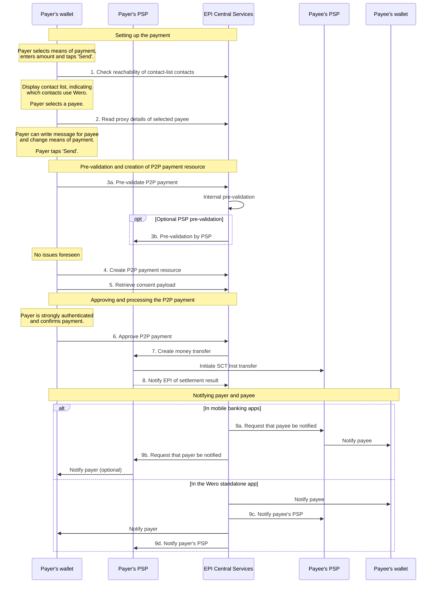

A consumer with a Wero digital wallet can send money to another consumer who also has a Wero digital wallet by creating a person-to-person payment (P2P payment).

Wero does not support sending money to people who are not registered Wero consumers.

See the latest designs in Figma here: 

<FigmaLinks />

## Audience

Software engineers and UX designers of consumer payment-service providers (PSPs)

## Process

The process for sending money from one consumer (the payer) to another (the payee) consists of the following steps:

1. The payer selects, in their Wero digital wallet, the means of payment representing the payment source that they want to send money from.

2. The payer enters the amount of money that they want to send.

   <Image src="https://files.readme.io/5cfd4be-image.png" align="center" width="30% " />

3. The payer taps **Send**.
   <Callout icon="📘" theme="info">
     ### Tips

     - **The order in which the payer specifies information is important.** Consumer PSPs must help to ensure general consistency of the Wero experience for Wero consumers across apps, across banks and across countries. In accordance with the [mobile UX principles](doc:guidelines-for-mobile-user-experience#5-help-make-the-wero-brand-universally-recognised-and-consistently-experienced), follow the EPI-defined payment flows. For P2P payments, ensure that the payer can specify information in the following order:
       1. Payment source and the amount to be sent. Then, tap **Send**. (The payer must be able to specify the payment source and the amount at the start and also be able to specify/modify this information before they tap **Send** again in step iv below.)
       2. Intended payee.
       3. Optional message and three large emojis.
       4. The payer taps **Send** again.
     - **Contact items and proxies** Other people’s contact items in the payer’s address book can be mobile phone numbers or email addresses. When a contact item is linked to the contact’s payment account, the contact item can take the place of the contact’s account number (IBAN) and is referred to as a _proxy_.
     - **Contacts who cannot receive P2P payments** EPI Central Services host a database of all the proxies that are registered in the Wero payment system. Contact items that are _not_ stored in this EPI proxy look-up database are _not_ proxies and therefore _cannot_ receive P2P payments.
   </Callout>

4. The payer's wallet calls the EPI proxy look-up service to check which contact items in the payer's address book are reachable in the Wero payment system. The endpoint call includes hashed versions of the contact items. These hashed versions are called [proxy hashes](doc:proxy-hashes).
   <Callout icon="📘" theme="info">
     ### Tip

     The term **proxy hash** is technically imprecise. A more precise name would be **contact-item hash** because some of the contact items that are looked up might turn out not to be proxies.&#x20;
   </Callout>

5. The wallet indicates to the payer which of their contacts use Wero.

   <Image src="https://files.readme.io/e066aaf-image.png" align="center" width="30% " />

   <Callout icon="📘" theme="info">
     ### Tip

     In the case of mobile banking apps, depending on how contact items are already dealt with in the apps, consumer PSPs can add a Wero label to each contact item in the list that is a Wero proxy, or they can create a section titled ‘Contacts using Wero’ at the top of the list, grouping all of the Wero proxies together.

     Learn more: [Integrate for seamless and intuitive access](doc:guidelines-for-mobile-user-experience).
   </Callout>

6. The payer specifies the payee in one of the following ways:

   1. They select a proxy of one of their contacts in their contact list, **OR**
   2. They type the mobile phone number or email address of the payee.
      <Callout icon="📘" theme="info">
        ### Tip

        Learn more about the process of specifying the payee in the [Selecting contacts and looking up proxies](doc:selecting-contacts-and-looking-up-proxies) documentation.
      </Callout>

7. The payer's wallet sends the hashed proxy to EPI Central Services and retrieves the payee's profile information. This information, which the wallet displays to the payer, currently consists of the display name of the payee. The display name can be in one of the following formats:

8. The full know-your-customer (KYC) name of the payee that the payee’s PSP provided to EPI.

9. A [masked (obfuscated) version](doc:obfuscating-consumer-names) of the KYC name if the payee has not chosen to share their full name.
   <Callout icon="📘" theme="info">
     ### Alternative

     The payer can also [scan a payee's QR code](doc:understanding-qr-codes-in-wero) when they are next to them to obtain the necessary information for sending them money.
   </Callout>

10. Optionally, the payer writes a message for the payee to read. The message can include three large emojis (_jumbojis_) at the top. Learn more in the [Rich text messages](doc:rich-text-messages) documentation.

    <Image src="https://files.readme.io/187d2fa-image.png" align="center" width="30% " />

11. Optional: The payer can change the means of payment if they decide that they do not want to use the means of payment from step 1 above.

    <Image src="https://files.readme.io/acfa794-image.png" align="center" width="30% " />

12. The payer taps **Send** again.

13. If the payer’s wallet is in the standalone app, EPI Central Services examine the proposed P2P payment for potential issues by performing the following types of checks (pre-validation):
    1. EPI internal checks (for example, checking whether the amount is more than €100,000, which is the limit for a P2P payment).
    2. Checks with the payer’s PSP (for example, checking whether the payer has enough money in their payment account to meet the P2P payment)—the PSP checks are performed only if the PSP has implemented the associated endpoint for [validating P2P payments](doc:validating-p2p-payments-from-standalone-apps).

14. If no issues are found, the payer’s wallet asks EPI Central Services to create a P2P-payment resource, which  incorporates all relevant parameters for the payment, such as the payee's proxy, the amount of money to be sent and other necessary details.

15. EPI Central Services send the P2P-payment resource, which is in the `Initial` state, to the payer's wallet.

16. In the payer’s wallet, the payer approves the P2P payment by being strongly authenticated.
    <Callout icon="📘" theme="info">
      ### Tips

      - Strong customer authentication (SCA) in the standalone app is performed through two independent authenticating factors. The first factor is the consumer’s possession of the physical mobile device, demonstrated by their ownership of the wallet private key, which is linked to the device through its hardware-backed key storage. The second factor is phone authentication through, for example, the consumer’s biometric characteristic that they established when they set up the standalone app.

      - In accordance with the [mobile UX principles](doc:guidelines-for-mobile-user-experience), EPI highly recommends that consumer PSPs make the SCA process in their mobile banking apps swift and seamless and rely on biometric technology. The page about [wallets and cryptography](doc:wallets-and-cryptography) describes a possible implementation scheme.
    </Callout>

17. The payer continues with one of the following flows:
    1. If the payer’s wallet is in a standalone app or if the payer’s PSP makes use of [consent tokens](doc:consent-model-concept#proof-of-consent) in their mobile banking app as proof of SCA and consent to P2P payments, continue with the _standard flow for sending money_, described below.
    2. If the payer’s PSP makes use of its own internal mechanisms (instead of consent tokens) in the mobile banking app as proof of SCA and consent to P2P payments, continue with the _alternative flow for sending money_, also described below.

<Callout icon="📘" theme="info">
  ### Tip

  **Use of consent tokens or not**

  Consent tokens can be used as proof of payer authentication and payment consent in all Wero [use cases](doc:consent-model-concept#use-cases). For the P2P payments use case, the process that makes use of consent tokens involves initiating a payment through a money-transfer endpoint that the payer’s PSP provides.

  - The standalone app makes use of [consent tokens](doc:consent-model-technical-description#consent-tokens) in _all_ Wero use cases.
  - For mobile banking apps, the use of consent tokens is mandatory for the e/m-commerce and point-of-sale use cases and is recommended (but optional) for the P2P and person-to-professional (P2Pro) use cases.

  The procedure for making and processing P2P payments differs depending on whether the payer’s PSP makes use of consent tokens for the P2P use case.

  - Some consumer PSPs that integrate Wero digital wallet functionality into their mobile banking apps make use of consent tokens in all Wero use cases to reduce overall complexity because, for example, they support both the standalone app and mobile banking apps.
  - Other consumer PSPs do not make use of consent tokens in the P2P and P2Pro use cases because they have decided to reduce implementation efforts by leveraging their own internal mechanisms in the mobile banking app for obtaining payers' approval and initiating SEPA instant credit transfers (SCT Insts).
</Callout>

## Standard flow for sending money (_with_ consent tokens)

After step 15 above, the process continues with the following steps:

1. The wallet unlocks the signing keys for consent tokens.
2. The wallet uses the private key to create a signed consent token that includes a payload taken from the P2P-payment resource. (Learn more: [Technical information about consent tokens](doc:consent-tokens).)
3. The wallet approves the P2P-payment resource with the consent token.
4. The P2P-payment resource transitions from the `Initial` state to the `Approved` state.
5. The wallet returns the approved P2P-payment resource, including the consent token, to EPI Central Services.
6. EPI Central Services send a money-transfer request to the payer's PSP (through a money-transfer endpoint in the Consumer PSP API). From the request, the payer's PSP obtains all the information necessary to construct a valid SCT Inst message, **including fraud-risk information (fraud score and primaryRiskVector for both the originator and the beneficiary of the P2P transaction).**
7. The payer’s PSP verifies the consent token and initiates an SCT Inst to the payee's PSP.
8. The payer's PSP notifies EPI Central Services of the settlement result in one of the following ways:
   1. Synchronously, by including the information in the response to the money transfer request
   2. Asynchronously, by communicating the result at a later time
9. A successful settlement causes the P2P-payment resource to transition to the final, `Settled` state.
10. A notification is sent to the payer confirming the successful transaction (in the case of a happy flow).
    1. If the payer’s wallet is in a standalone Wero digital wallet app, EPI Central Services send the notification directly to the app. (EPI Central Services also send a notification to the payer's PSP.)
    2. If the payer’s wallet is in a mobile banking app, EPI Central Services send the notification to the payer’s PSP, which optionally sends a notification to the app.

       

       <Callout icon="📘" theme="info">
         ### Tip

         A notification endpoint that is implemented by consumer PSPs enables EPI Central Services to request consumer PSPs to send notifications to consumers who have Wero digital wallets integrated into their mobile banking apps. Learn more: [Consumer notifications](doc:consumer-notifications).
       </Callout>
11. Simultaneously, a notification is sent to the payee’s wallets that contain means of payment for which the payment account is linked to the specified proxy. The notification informs the payee of the payment they have received.
    1. Again, if a wallet of the payee is in a standalone Wero digital wallet app, EPI Central Services send the notification directly to the app. (EPI Central Services also send a notification to the payee's PSP.)
    2. If a wallet of the payee is in a mobile banking app, EPI Central Services send the notification to the payee’s PSP, which sends a notification to the app.

### Sequence diagram for the standard flow

The following sequence diagram illustrates a happy case in the standard send-money flow, which makes use of consent tokens. In this example, the payer selects the intended payee from the contact list. The numbered steps in the diagram correspond to the numbers in the table below the diagram.

<Image src="https://files.readme.io/529af971681d6724745cf4a9c55f5bc1afa0efc4d52b2766a30bf29613d64357-tmp.svg" align="center" border={true} />

### Endpoint calls in the standard flow

| Number (in diagram above) | Caller               | Called                      | Endpoint call                                                                                                                                                                                                                                                                                                                                                                                                                                                                                                                                                                                                                                                                                                                          |
| :----------------------------- | :------------------- | :-------------------------- | :------------------------------------------------------------------------------------------------------------------------------------------------------------------------------------------------------------------------------------------------------------------------------------------------------------------------------------------------------------------------------------------------------------------------------------------------------------------------------------------------------------------------------------------------------------------------------------------------------------------------------------------------------------------------------------------------------------------------------------- |
| 1                              | Payer's wallet       | EPI Central Services        | [List eligible proxy hashes](ref:post-proxy-indicators) (that is, check reachability of contact-list contacts).                                                                                                                                                                                                                                                                                                                                                                                                                                                                                                                                                                                                                        |
| 2                              | Payer's wallet       | EPI Central Services        | [Retrieve proxy details of selected payee](ref:get-proxies-proxyhash).                                                                                                                                                                                                                                                                                                                                                                                                                                                                                                                                                                                                                                                                 |
| 3a                             | Payer's wallet       | EPI Central Services        | Ask EPI Central Services to pre-validate the P2P payment—this endpoint call is internal to EPI and is made _only_ if the payer's wallet is in a standalone Wero app.Learn more: [Validating P2P payments from standalone apps](doc:validating-p2p-payments-from-standalone-apps).                                                                                                                                                                                                                                                                                                                                                                                                                                                      |
| 3b                             | EPI Central Services | Payer's PSP                 | [Ask the payer’s PSP to pre-validate the P2P payment](ref:post-payment-validation).Called only if the payer's wallet is in a standalone Wero app and the payer’s PSP has implemented the endpoint in the consumer PSP API.                                                                                                                                                                                                                                                                                                                                                                                                                                                                                                             |
| 4                              | Payer's wallet       | EPI Central Services        | [Create a P2P payment](ref:post-p2p-payments).                                                                                                                                                                                                                                                                                                                                                                                                                                                                                                                                                                                                                                                                                         |
| 5                              | Payer's wallet       | EPI Central Services        | [Retrieve a consent payload](https://docs.epicompany.eu/platform/reference/get-api-p2p-payments-p2ppaymentid-consent-payload).                                                                                                                                                                                                                                                                                                                                                                                                                                                                                                                                                                                                         |
| 6                              | Payer's wallet       | EPI Central Services        | [Approve a P2P payment](ref:put-p2p-payments-p2ppaymentid-approval).                                                                                                                                                                                                                                                                                                                                                                                                                                                                                                                                                                                                                                                                   |
| 7                              | EPI Central Services | Payer's PSP                 | [Create a money transfer](ref:put-money-transfers).                                                                                                                                                                                                                                                                                                                                                                                                                                                                                                                                                                                                                                                                                    |
| 8                              | Payer's PSP          | EPI Central Services        | In the response to the above money-transfer call **or** in a new call to [notify EPI of the settlement result](ref:post-consumer-psp-events).                                                                                                                                                                                                                                                                                                                                                                                                                                                                                                                                                                                          |
| 9 (a, b, c, d)            | EPI Central Services | Payer's PSP and payee's PSP | **Mobile banking apps**: EPI Central Services [send a push notification request](ref:send-notification) to the payee's PSP and the payer's PSP for them to notify the payee and (optionally) the payer respectively of the successful settlement if their Wero digital wallets are in mobile banking apps.  **Standalone app**: EPI Central Services send a notification of the successful settlement _directly_ to the payee and payer if their Wero digital wallets are in the standalone app. In this case, EPI Central Services still [send a notification](ref:send-notification) to the payee's PSP and the payer's PSP so that, for example, the payee's PSP can notify a wallet-less payee of the settlement result. |

## Recipe

<Recipe slug="p2p-sending-money" title="P2P: Sending money" />

## Alternative flow for sending money (_without_ consent tokens)

<Callout icon="❗️" theme="error">
  ### Do not implement this flow

  The alternative flow was developed by EPI as part of a MVP. New members should not implement this flow and instead use the standard flow, which reuses the consent token mechanics also used in our e/m-commerce and POS payments.
</Callout>

After completing step 15 of the <Anchor target="_blank" href="doc:sending-money/#process">Process section</Anchor>, mobile banking apps can follow an alternative flow that relies on existing mechanisms in the app for capturing the payer's consent to the payment and initiating an SCT Inst.

In this scenario, the payer's PSP does not create or provide a signed consent token. Therefore, EPI Central Services does not invoke the money transfer endpoint. Instead, the consumer PSP accesses the P2P-payment resource to obtain all the information that is necessary for creating an SCT Inst message and uses the existing mechanisms to initiate settlement of the P2P payment. However, the payer's PSP must notify EPI Central Services of the settlement outcome, as in the standard flow above.

### Obtaining fraud risk information

Optional: The payer's PSP can request from EPI Central Services a fraud risk assessment (fraud score) of the pending P2P transaction. Payers' PSPs can take the fraud scores into account when they are determining whether to approve or reject the payment.

### Sequence diagram for the alternative flow

The following sequence diagram illustrates a happy case in the alternative send-money flow, which does _not_ make use of consent tokens. In this example, the payer selects the intended payee from the contact list. The numbered steps in the diagram correspond to the numbers in the table below the diagram.

<Image src="https://files.readme.io/c91da50-use-case-p2p-payment-alternative-flow.svg" align="center" border={true} />

## Endpoint calls in the alternative flow

| Number (in diagram above) | Caller               | Called                      | Endpoint call                                                                                                                                                                                                                                                                                                                                                                                                                                                                                                                                                                                                                                                                                                                              |
| :----------------------------- | :------------------- | :-------------------------- | :----------------------------------------------------------------------------------------------------------------------------------------------------------------------------------------------------------------------------------------------------------------------------------------------------------------------------------------------------------------------------------------------------------------------------------------------------------------------------------------------------------------------------------------------------------------------------------------------------------------------------------------------------------------------------------------------------------------------------------------- |
| 1                              | Payer's Wallet       | EPI Central Services        | [List eligible proxy hashes](ref:post-proxy-indicators) (that is, check reachability of contact-list contacts).                                                                                                                                                                                                                                                                                                                                                                                                                                                                                                                                                                                                                            |
| 2                              | Payer's Wallet       | EPI Central Services        | [Retrieve proxy details of selected payee](ref:get-proxies-proxyhash).                                                                                                                                                                                                                                                                                                                                                                                                                                                                                                                                                                                                                                                                     |
| 3                              | Payer's Wallet       | EPI Central Services        | [Create a P2P payment](ref:post-p2p-payments).                                                                                                                                                                                                                                                                                                                                                                                                                                                                                                                                                                                                                                                                                             |
| 4                              | Payer's PSP          | EPI Central Services        | [Obtain fraud risk information](ref:post-api-p2p-payments-p2ppaymentid-fraud-risk-information).                                                                                                                                                                                                                                                                                                                                                                                                                                                                                                                                                                                                                                            |
| 5                              | Payer's PSP          | EPI Central Services        | [Retrieve dataset required for initiating an SCT Inst](ref:get-api-p2p-payments-p2ppaymentid-payment-dataset).                                                                                                                                                                                                                                                                                                                                                                                                                                                                                                                                                                                                                             |
| 6                              | Payer's PSP          | EPI Central Services        | [Notify EPI of the settlement result](ref:post-consumer-psp-events).                                                                                                                                                                                                                                                                                                                                                                                                                                                                                                                                                                                                                                                                       |
| 7 (a, b, c, d)            | EPI Central Services | Payer's PSP and payee's PSP | **Mobile banking apps**: EPI Central Services [send a push notification request](ref:send-notification)  to the payee's PSP and the payer's PSP for them to notify the payee and (optionally) the payer respectively of the successful settlement if their Wero digital wallets are in mobile banking apps.  **Standalone app**: EPI Central Services send a notification of the successful settlement _directly_ to the payee and payer if their Wero digital wallets are in the standalone app. In this case, EPI Central Services _still_ [send a notification](ref:send-notification)  to the payee's PSP and the payer's PSP so that, for example, the payee's PSP can notify a wallet-less payee of the settlement result. |

## P2P-payment status model

### Simple version

Consumer PSPs can inform EPI Central Services of the settlement result _synchronously_, that is, directly in the response to a money transfer request. The corresponding, simple version of the P2P-payment status model contains the following states:

- After EPI Central Services creates a P2P-payment resource, the resource is in the `Initial` state.
- After the payer is authenticated to approve the payment, the resource transitions to the `Approved` state.
- After EPI Central Services ask the payer’s PSP to initiate a money transfer, the payer’s PSP returns the result of the request, and the resource transitions to a final state of `Rejected`, `Settled` or `Failed`.

<Image src="https://files.readme.io/56fa452-image.png" align="center" width="80% " border={true} />

<Callout icon="📘" theme="info">
  ### Difference between a 'Rejected' and 'Failed' payment

  **Rejected**

  The payer’s PSP rejected the payment; it did not attempt to settle the payment.

  **Failed**

  The payer’s PSP attempted to settle the payment, but the settlement failed. Note that the status is `Failed` even if the _payee's_ PSP rejected the payment.
</Callout>

### Version that includes the state of 'Accepted'

Consumer PSPs can choose to inform EPI Central Services of the settlement result _asynchronously_. In this flow, if the consumer PSP does not reject the money transfer request, it first acknowledges only _receipt_ of the request, and the P2P-payment resource transitions to the `Accepted` state. The consumer PSP can then no longer reject the request. At a later time, the consumer PSP informs EPI Central Services of the settlement result (`Settled` or `Failed`).

<Image src="https://developer.epicompany.eu/readme-images/p2p-send-money-flow.png" align="center" border={true} />

### Skipping the 'Approved' and/or 'Accepted' states

Consumer PSPs can choose to employ their own internal mechanisms to obtain the payer's approval and initiate the settlement. They might decide, for example, that use of these mechanisms reduces implementation efforts on their side. In this case, they must still create the P2P-payment resource in its `Initial` state but can skip the `Approved` and/or `Accepted` states.

## P2P-payment fees and maximum amounts

For money transfers through the Wero P2P payment service, the consumer pays no fees. The consumer PSP sets its own limits (but not more than €100,000) as to how much money a consumer can send in a single Wero P2P payment.

A consumer PSP that supports the standalone Wero digital wallet app must communicate those limits to EPI Central Services through an endpoint so that EPI Central Services can enforce the limits at the time that the consumer initiates a transaction. If the consumer PSP does not communicate the limits through the endpoint, EPI Central Services permits the consumer to attempt to send up to €100,000 in a single P2P payment. However, payment settlement can fail if the consumer PSP's (non-communicated) limit is less than €100,000.

### Exceptional scenarios

The following exceptional scenarios might arise during the send-money flow due to functional or technical issues.

### Payment initiation is rejected for a functional reason

The initiation of a P2P payment through the money-transfer endpoint might be rejected for various functional reasons. For instance, the payer's PSP might not authorise the payment due to insufficient funds, or the internal risk management mechanisms of the payer's PSP might reject the payment for various risk-related reasons.

In these cases, the P2P-payment resource transitions to a final state of `Rejected`, and the payer is notified of the rejection.

### Payment initiation fails for a technical reason

Initiation of a P2P payment might fail for various technical reasons. Depending on the reason, EPI Central Services might repeat the money-transfer request within a short time. (See the table of error cases below.) [Idempotency mechanisms](ref:idempotency) guarantee that these repeated attempts do not lead to double spending.

### The P2P-payment resource does not transition to one of the final states

If a P2P-payment resource is stuck in a non-final state, EPI does not want the consumer to retry the transaction because the first attempt might have been successful despite the non-final state. The Wero digital wallet requests the consumer to contact the customer support team to resolve the issue. (See also code AG09 in the table of [SCT Inst failures in P2P payments](doc:sct-inst-failure-handling).)

### Error cases

The following errors might occur during the send-money flow. The list is not exhaustive; more error cases will be added in the future. For specific SCT Inst failures and countermeasures, see [SCT Inst failure handling](doc:sct-inst-failure-handling).

| Endpoint call                                                                                                              | Error type | Description                                                                                                                                                                             | EPI back-end action                                                                                                                                                   | UX recommendation                                                                                                                                      |
| :------------------------------------------------------------------------------------------------------------------------- | :--------- | :-------------------------------------------------------------------------------------------------------------------------------------------------------------------------------------- | :-------------------------------------------------------------------------------------------------------------------------------------------------------------------- | :----------------------------------------------------------------------------------------------------------------------------------------------------- |
| [Create a P2P payment](ref:post-p2p-payments)                                                                              | 4xx        | Payer's PSP deactivated the payer's account, so payer cannot send or request money.                                                                                                     | Notify the front end that the payment cannot be created because the account is deactivated.                                                                           | Grey out the account; advise payer to reach out to their bank (payer's PSP).                                                                           |
| [Create a P2P payment](ref:post-p2p-payments)                                                                              | 4xx        | Wero digital wallet is not provisioned with means of payment (= empty wallet).                                                                                                          | Notify the front end that the payment cannot be created because the wallet is not provisioned with means of payment.                                                  | Redirect payer to account provisioning.                                                                                                                |
| [Create a P2P payment](ref:post-p2p-payments)                                                                              | 4xx        | Payer has exceeded rate limits for creating payments.                                                                                                                                   | Notify front end that the payment cannot be created.                                                                                                                  | Inform payer that the transaction is not possible.                                                                                                     |
| [Create a P2P payment](ref:post-p2p-payments)                                                                              | 5xx        | EPI Central Services cannot be reached by the standalone app or mobile banking app, or an unexpected error occurred.                                                                    | N/A                                                                                                                                                                   | Inform payer.Title: Technical errorMessage: P2P payment could not be created.Actions: retry or cancel.                                                 |
| [Create a P2P payment](ref:post-p2p-payments)                                                                              | 5xx        | Payer's PSP cannot be reached by EPI Central Services.                                                                                                                                  | Notify front end that the payment cannot be created.                                                                                                                  | Inform payer.Title: Technical errorMessage: P2P payment could not be created.Actions: retry or cancel.                                                 |
| [Send a push notification](ref:send-notification)                                                                          | 5xx        | **Wero standalone app:** EPI Central Services API fails to notify the payee of the P2P payment.                                                                                         | Retry until payee receives the notification about the P2P payment.                                                                                                    | N/A                                                                                                                                                    |
| [Send a push notification](ref:send-notification)                                                                          | 5xx        | **Mobile banking app:** EPI Central Services API fails to request payee's PSP to send a notification about the P2P payment to payee's wallet.                                           | Retry until payee's PSP receives request to inform payee.                                                                                                             | N/A                                                                                                                                                    |
| [Send a push notification](ref:send-notification)                                                                          | 5xx        | **Mobile banking app:** EPI Central Services API fails to request the payer's PSP to send a notification about the P2P payment to payer's wallet.                                       | Retry until payer's PSP receives request to inform payer.                                                                                                             | N/A                                                                                                                                                    |
| [Validate an initial P2P payment](ref:post-payment-validation)                                                             | 4xx        | The transfer amount contains characters, and the front-end validation fails.                                                                                                            | Notify the front end that the payment cannot be created because amount contains invalid characters.                                                                   | Inform payer that the transaction is not possible.                                                                                                     |
| [Validate an initial P2P payment](ref:post-payment-validation)                                                             | 4xx        | The payer enters a text of over 140 characters, and the front-end validation fails.                                                                                                     | Notify the front end that the message is too long.                                                                                                                    | Inform payer that the message cannot have more than 140 characters.                                                                                    |
| [List eligible proxy hashes](ref:post-proxy-indicators)                                                                    | 5xx        | The payer granted Wero digital wallet access to their address book, but the proxy look-up fails to list eligible proxy hashes due to timeout or other technical errors.                 | N/A                                                                                                                                                                   | Inform payer. Non-blocking error messageTitle: Contacts couldn't loadMessage: Try to reload or come back later.Actions: retry or cancel.          |
| [Retrieve proxy details of selected payee](ref:get-proxies-proxyhash)                                                      | 5xx        | Wero digital wallet cannot read the payee's payment source profile from EPI Central Services API.                                                                                       | N/A                                                                                                                                                                   | Inform payer.Title: Technical errorMessage: P2P payment could not be created.Actions: retry or cancel.                                                 |
| [Create a money transfer](ref:put-money-transfers) and [Approve a P2P payment](ref:put-p2p-payments-p2ppaymentid-approval) | N/A        | Precondition: money transfer was created (status: "Accepted"). Payer's PSP does not inform EPI Central Services of settlement result within time limit (time limit to be defined). | After initial payment creation, notify front end that the transaction was accepted but not processed. The payment remains pending. Further action to be defined. | Inform payer that the transaction is pending and ask them _not_ to send the money again to avoid possible duplications.                                |
| [Create a money transfer](ref:put-money-transfers) and [Approve a P2P payment](ref:put-p2p-payments-p2ppaymentid-approval) | 4xx        | Consumer PSP declines Wero transaction due to suspected fraud related to the payer's account.                                                                                           | Notify front end about failure of the transaction.                                                                                                                    | Inform payer.Title: Security IssueMessage: Your bank has flagged a security issue. Please contact them.Actions: OK                                     |
| [Create a money transfer](ref:put-money-transfers) and [Approve a P2P payment](ref:put-p2p-payments-p2ppaymentid-approval) | 4xx        | Consumer PSP declines Wero transaction due to suspected money laundering.                                                                                                               | Notify front end about failure of the transaction.                                                                                                                    | Inform payer.Title: Security IssueMessage: Your bank has flagged a security issue. Please contact them.Actions: OK                                     |
| [Validate an initial P2P payment](ref:post-payment-validation) and [Create a money transfer](ref:put-money-transfers)      | 4xx        | Payer tries to send more money than is in their account.                                                                                                                                | Notify front end about failure of the transaction because the account balance has been exceeded.                                                                      | Inform payer.Title: Insufficient fundsMessage: Choose a different payment method, or add money to your account.Actions: OK                             |
| [Create a P2P payment](ref:post-p2p-payments)                                                                              | 4xx        | Payer tries to send more than the maximum permitted amount in a single transaction.                                                                                                     | Notify the front end that the payment cannot be created because the amount is too big.                                                                                | Inform payer of the maximum amount that they can send in a single transaction.                                                                         |
| [Create a P2P payment](ref:post-p2p-payments)                                                                              | 4xx        | Payer tries to send less than €0.01.                                                                                                                                                    | Notify the front end that the payment cannot be created, because the amount is too small.                                                                             | Inform payer that they must send at least €0.01.                                                                                                       |
| [Create a P2P payment](ref:post-p2p-payments)                                                                              | 5xx        | EPI Central Services API fails to create a P2P-payment resource.                                                                                                                        | N/A                                                                                                                                                                   | Inform payer.Title: Technical errorMessage: P2P payment could not be created.Actions: retry or cancel.                                                 |
| [Create a money transfer](ref:put-money-transfers) and [Approve a P2P payment](ref:put-p2p-payments-p2ppaymentid-approval) | 5xx        | **Wero standalone app:** Payer's PSP fails to create a money transfer.                                                                                                                  | Retry.                                                                                                                                                                | Inform payer.Title: Technical errorMessage: We could not reach your bank. Try again later.Actions: retry or cancel.                                    |
| [Approve a P2P payment](ref:put-p2p-payments-p2ppaymentid-approval)                                                        | N/A        | SCA fails. Payer cannot approve a transaction with their SCA.                                                                                                                           | P2P-payment resource expires after time limit.                                                                                                                        | Inform payer and ask them to retry (2 retries possible); if retries do not work, cancel transaction. P2P-payment resource will expire in the back end. |
| [Approve a P2P payment](ref:put-p2p-payments-p2ppaymentid-approval)                                                        | 4xx        | Changed Wero proxy. Wero tag of the payee is changed or deleted at the moment the payer sends money.                                                                                    | Notify front end about failure of the transaction.                                                                                                                    | Inform payer (generic message).                                                                                                                        |
| [Approve a P2P payment](ref:put-p2p-payments-p2ppaymentid-approval)                                                        | 4xx        | Payer tries to send money to the same account from which the money is to be sent; even if it is registered under another Wero proxy.                                                    | Decline transaction.                                                                                                                                                  | Inform payer.Title: Cannot send money to same accountMessage: You cannot send money to the account you are sending from.Actions: OK                    |
| [Approve a P2P payment](ref:put-p2p-payments-p2ppaymentid-approval)                                                        | 4xx        | Payer reached the transfer limit of their bank (payer's PSP). Payer's PSP rejects money transfer instantly.                                                                             | Notify front end about failure of the transaction. Payer's PSP must submit failure code and reason.                                                                   | Inform payer.Title: Transfer limit reachedMessage: You have reached your transfer limit.Actions: OK                                                    |

## Identifiers used in P2P flows

The following IDs are used to link all the different steps in a payment from the request and initiation phase to the settlement phase.

| Identifier                                   | Format | Description                                                                                                                                                                                                                                                                           |
| :------------------------------------------- | :----- | :------------------------------------------------------------------------------------------------------------------------------------------------------------------------------------------------------------------------------------------------------------------------------------ |
| P2P payment ID                               | UUID   | Identifier of a payment                                                                                                                                                                                                                                                               |
| P2P request ID                               | UUID   | Identifier of a request, unrelated to the payment ID. A request resource can contain an embedded payment object, which contains a payment ID.                                                                                                                                    |
| P2P open request ID                          | UUID   | Identifier of an open request, unrelated to the payment ID. An open request resource can contain an embedded payment object, which contains a payment ID.                                                                                                                        |
| [Money transfer ID](ref:put-money-transfers) | UUID   | Used in the standard flow. This is the P2P payment ID.                                                                                                                                                                                                                                |
| Originator reference                         | String | The P2P payment ID with its hyphens removed.Sent either through  calling [retrieve dataset required for initiating an SCT Inst \[Consumer PSP\]](ref:get-api-p2p-payments-p2ppaymentid-payment-dataset) or from the [create a money transfer](ref:put-money-transfers) endpoint call. |

## Related topics

- [QR codes for sending or requesting money](doc:understanding-qr-codes-in-wero)
- [Consumer notifications](doc:consumer-notifications)
- [Error handling](ref:error-handling)
- [Rate-limiting](doc:rate-limiting)

{/* related-api-suggestions:
post-api-p2p-payments-p2ppaymentid-fraud-risk-information
get-p2p-payments
*/}