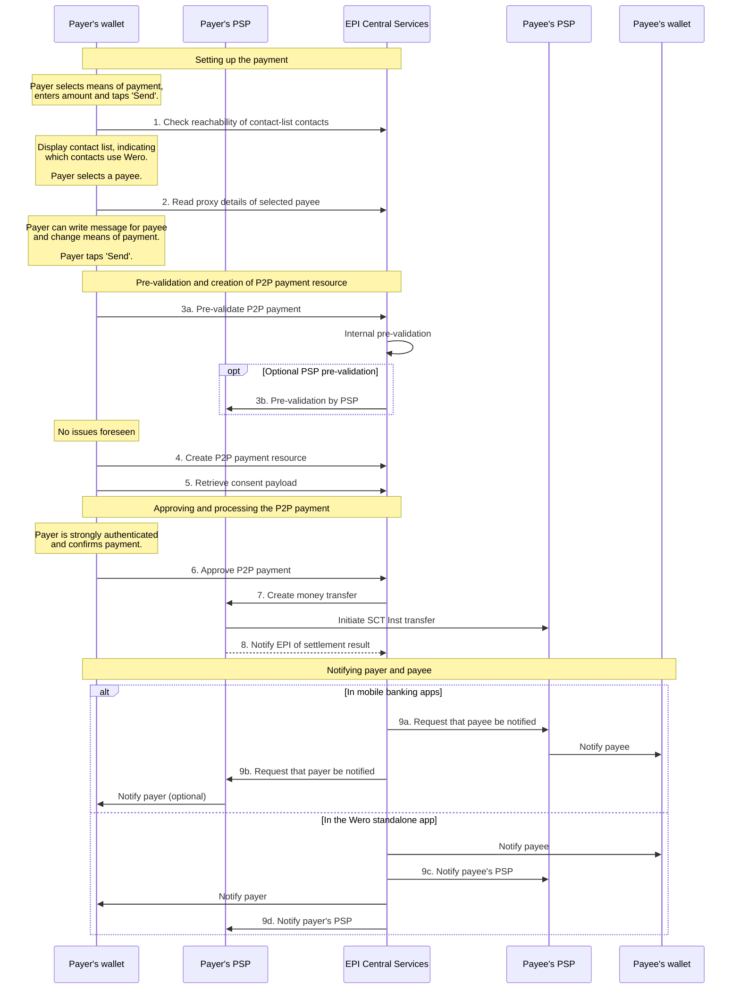

<Image src="https://files.readme.io/529af971681d6724745cf4a9c55f5bc1afa0efc4d52b2766a30bf29613d64357-tmp.svg" align="center" border={true} />

### Endpoint calls in the standard flow

| Number (in diagram above) | Caller               | Called                      | Endpoint call                                                                                                                                                                                                                                                                                                                                                                                                                                                                                                                                                                                                                                                                                                                          |
| :----------------------------- | :------------------- | :-------------------------- | :------------------------------------------------------------------------------------------------------------------------------------------------------------------------------------------------------------------------------------------------------------------------------------------------------------------------------------------------------------------------------------------------------------------------------------------------------------------------------------------------------------------------------------------------------------------------------------------------------------------------------------------------------------------------------------------------------------------------------------- |
| 1                              | Payer's wallet       | EPI Central Services        | [List eligible proxy hashes](ref:post-proxy-indicators) (that is, check reachability of contact-list contacts).                                                                                                                                                                                                                                                                                                                                                                                                                                                                                                                                                                                                                        |
| 2                              | Payer's wallet       | EPI Central Services        | [Retrieve proxy details of selected payee](ref:get-proxies-proxyhash).                                                                                                                                                                                                                                                                                                                                                                                                                                                                                                                                                                                                                                                                 |
| 3a                             | Payer's wallet       | EPI Central Services        | Ask EPI Central Services to pre-validate the P2P payment—this endpoint call is internal to EPI and is made _only_ if the payer's wallet is in a standalone Wero app.Learn more: [Validating P2P payments from standalone apps](doc:validating-p2p-payments-from-standalone-apps).                                                                                                                                                                                                                                                                                                                                                                                                                                                      |
| 3b                             | EPI Central Services | Payer's PSP                 | [Ask the payer’s PSP to pre-validate the P2P payment](ref:post-payment-validation).Called only if the payer's wallet is in a standalone Wero app and the payer’s PSP has implemented the endpoint in the consumer PSP API.                                                                                                                                                                                                                                                                                                                                                                                                                                                                                                             |
| 4                              | Payer's wallet       | EPI Central Services        | [Create a P2P payment](ref:post-p2p-payments).                                                                                                                                                                                                                                                                                                                                                                                                                                                                                                                                                                                                                                                                                         |
| 5                              | Payer's wallet       | EPI Central Services        | [Retrieve a consent payload](https://docs.epicompany.eu/platform/reference/get-api-p2p-payments-p2ppaymentid-consent-payload).                                                                                                                                                                                                                                                                                                                                                                                                                                                                                                                                                                                                         |
| 6                              | Payer's wallet       | EPI Central Services        | [Approve a P2P payment](ref:put-p2p-payments-p2ppaymentid-approval).                                                                                                                                                                                                                                                                                                                                                                                                                                                                                                                                                                                                                                                                   |
| 7                              | EPI Central Services | Payer's PSP                 | [Create a money transfer](ref:put-money-transfers).                                                                                                                                                                                                                                                                                                                                                                                                                                                                                                                                                                                                                                                                                    |
| 8                              | Payer's PSP          | EPI Central Services        | In the response to the above money-transfer call **or** in a new call to [notify EPI of the settlement result](ref:post-consumer-psp-events).                                                                                                                                                                                                                                                                                                                                                                                                                                                                                                                                                                                          |
| 9 (a, b, c, d)            | EPI Central Services | Payer's PSP and payee's PSP | **Mobile banking apps**: EPI Central Services [send a push notification request](ref:send-notification) to the payee's PSP and the payer's PSP for them to notify the payee and (optionally) the payer respectively of the successful settlement if their Wero digital wallets are in mobile banking apps.  **Standalone app**: EPI Central Services send a notification of the successful settlement _directly_ to the payee and payer if their Wero digital wallets are in the standalone app. In this case, EPI Central Services still [send a notification](ref:send-notification) to the payee's PSP and the payer's PSP so that, for example, the payee's PSP can notify a wallet-less payee of the settlement result. |

## Recipe

<Recipe slug="p2p-sending-money" title="P2P: Sending money" />

## Alternative flow for sending money (_without_ consent tokens)

<Callout icon="❗️" theme="error">
  ### Do not implement this flow

  The alternative flow was developed by EPI as part of a MVP. New members should not implement this flow and instead use the standard flow, which reuses the consent token mechanics also used in our e/m-commerce and POS payments.
</Callout>

After completing step 15 of the <Anchor target="_blank" href="doc:sending-money/#process">Process section</Anchor>, mobile banking apps can follow an alternative flow that relies on existing mechanisms in the app for capturing the payer's consent to the payment and initiating an SCT Inst.

In this scenario, the payer's PSP does not create or provide a signed consent token. Therefore, EPI Central Services does not invoke the money transfer endpoint. Instead, the consumer PSP accesses the P2P-payment resource to obtain all the information that is necessary for creating an SCT Inst message and uses the existing mechanisms to initiate settlement of the P2P payment. However, the payer's PSP must notify EPI Central Services of the settlement outcome, as in the standard flow above.

### Obtaining fraud risk information

Optional: The payer's PSP can request from EPI Central Services a fraud risk assessment (fraud score) of the pending P2P transaction. Payers' PSPs can take the fraud scores into account when they are determining whether to approve or reject the payment.

### Sequence diagram for the alternative flow

The following sequence diagram illustrates a happy case in the alternative send-money flow, which does _not_ make use of consent tokens. In this example, the payer selects the intended payee from the contact list. The numbered steps in the diagram correspond to the numbers in the table below the diagram.

<Image src="https://files.readme.io/c91da50-use-case-p2p-payment-alternative-flow.svg" align="center" border={true} />

## Endpoint calls in the alternative flow

| Number (in diagram above) | Caller               | Called                      | Endpoint call                                                                                                                                                                                                                                                                                                                                                                                                                                                                                                                                                                                                                                                                                                                              |
| :----------------------------- | :------------------- | :-------------------------- | :----------------------------------------------------------------------------------------------------------------------------------------------------------------------------------------------------------------------------------------------------------------------------------------------------------------------------------------------------------------------------------------------------------------------------------------------------------------------------------------------------------------------------------------------------------------------------------------------------------------------------------------------------------------------------------------------------------------------------------------- |
| 1                              | Payer's Wallet       | EPI Central Services        | [List eligible proxy hashes](ref:post-proxy-indicators) (that is, check reachability of contact-list contacts).                                                                                                                                                                                                                                                                                                                                                                                                                                                                                                                                                                                                                            |
| 2                              | Payer's Wallet       | EPI Central Services        | [Retrieve proxy details of selected payee](ref:get-proxies-proxyhash).                                                                                                                                                                                                                                                                                                                                                                                                                                                                                                                                                                                                                                                                     |
| 3                              | Payer's Wallet       | EPI Central Services        | [Create a P2P payment](ref:post-p2p-payments).                                                                                                                                                                                                                                                                                                                                                                                                                                                                                                                                                                                                                                                                                             |
| 4                              | Payer's PSP          | EPI Central Services        | [Obtain fraud risk information](ref:post-api-p2p-payments-p2ppaymentid-fraud-risk-information).                                                                                                                                                                                                                                                                                                                                                                                                                                                                                                                                                                                                                                            |
| 5                              | Payer's PSP          | EPI Central Services        | [Retrieve dataset required for initiating an SCT Inst](ref:get-api-p2p-payments-p2ppaymentid-payment-dataset).                                                                                                                                                                                                                                                                                                                                                                                                                                                                                                                                                                                                                             |
| 6                              | Payer's PSP          | EPI Central Services        | [Notify EPI of the settlement result](ref:post-consumer-psp-events).                                                                                                                                                                                                                                                                                                                                                                                                                                                                                                                                                                                                                                                                       |
| 7 (a, b, c, d)            | EPI Central Services | Payer's PSP and payee's PSP | **Mobile banking apps**: EPI Central Services [send a push notification request](ref:send-notification)  to the payee's PSP and the payer's PSP for them to notify the payee and (optionally) the payer respectively of the successful settlement if their Wero digital wallets are in mobile banking apps.  **Standalone app**: EPI Central Services send a notification of the successful settlement _directly_ to the payee and payer if their Wero digital wallets are in the standalone app. In this case, EPI Central Services _still_ [send a notification](ref:send-notification)  to the payee's PSP and the payer's PSP so that, for example, the payee's PSP can notify a wallet-less payee of the settlement result. |

## P2P-payment status model

### Simple version

Consumer PSPs can inform EPI Central Services of the settlement result _synchronously_, that is, directly in the response to a money transfer request. The corresponding, simple version of the P2P-payment status model contains the following states:

- After EPI Central Services creates a P2P-payment resource, the resource is in the `Initial` state.
- After the payer is authenticated to approve the payment, the resource transitions to the `Approved` state.
- After EPI Central Services ask the payer’s PSP to initiate a money transfer, the payer’s PSP returns the result of the request, and the resource transitions to a final state of `Rejected`, `Settled` or `Failed`.

<Image src="https://files.readme.io/56fa452-image.png" align="center" width="80% " border={true} />

<Callout icon="📘" theme="info">
  ### Difference between a 'Rejected' and 'Failed' payment

  **Rejected**

  The payer’s PSP rejected the payment; it did not attempt to settle the payment.

  **Failed**

  The payer’s PSP attempted to settle the payment, but the settlement failed. Note that the status is `Failed` even if the _payee's_ PSP rejected the payment.
</Callout>

### Version that includes the state of 'Accepted'

Consumer PSPs can choose to inform EPI Central Services of the settlement result _asynchronously_. In this flow, if the consumer PSP does not reject the money transfer request, it first acknowledges only _receipt_ of the request, and the P2P-payment resource transitions to the `Accepted` state. The consumer PSP can then no longer reject the request. At a later time, the consumer PSP informs EPI Central Services of the settlement result (`Settled` or `Failed`).

<Image src="https://developer.epicompany.eu/readme-images/p2p-send-money-flow.png" align="center" border={true} />

### Skipping the 'Approved' and/or 'Accepted' states

Consumer PSPs can choose to employ their own internal mechanisms to obtain the payer's approval and initiate the settlement. They might decide, for example, that use of these mechanisms reduces implementation efforts on their side. In this case, they must still create the P2P-payment resource in its `Initial` state but can skip the `Approved` and/or `Accepted` states.

## P2P-payment fees and maximum amounts

For money transfers through the Wero P2P payment service, the consumer pays no fees. The consumer PSP sets its own limits (but not more than €100,000) as to how much money a consumer can send in a single Wero P2P payment.

A consumer PSP that supports the standalone Wero digital wallet app must communicate those limits to EPI Central Services through an endpoint so that EPI Central Services can enforce the limits at the time that the consumer initiates a transaction. If the consumer PSP does not communicate the limits through the endpoint, EPI Central Services permits the consumer to attempt to send up to €100,000 in a single P2P payment. However, payment settlement can fail if the consumer PSP's (non-communicated) limit is less than €100,000.

### Exceptional scenarios

The following exceptional scenarios might arise during the send-money flow due to functional or technical issues.

### Payment initiation is rejected for a functional reason

The initiation of a P2P payment through the money-transfer endpoint might be rejected for various functional reasons. For instance, the payer's PSP might not authorise the payment due to insufficient funds, or the internal risk management mechanisms of the payer's PSP might reject the payment for various risk-related reasons.

In these cases, the P2P-payment resource transitions to a final state of `Rejected`, and the payer is notified of the rejection.

### Payment initiation fails for a technical reason

Initiation of a P2P payment might fail for various technical reasons. Depending on the reason, EPI Central Services might repeat the money-transfer request within a short time. (See the table of error cases below.) [Idempotency mechanisms](ref:idempotency) guarantee that these repeated attempts do not lead to double spending.

### The P2P-payment resource does not transition to one of the final states

If a P2P-payment resource is stuck in a non-final state, EPI does not want the consumer to retry the transaction because the first attempt might have been successful despite the non-final state. The Wero digital wallet requests the consumer to contact the customer support team to resolve the issue. (See also code AG09 in the table of [SCT Inst failures in P2P payments](doc:sct-inst-failure-handling).)

### Error cases

The following errors might occur during the send-money flow. The list is not exhaustive; more error cases will be added in the future. For specific SCT Inst failures and countermeasures, see [SCT Inst failure handling](doc:sct-inst-failure-handling).

| Endpoint call                                                                                                              | Error type | Description                                                                                                                                                                             | EPI back-end action                                                                                                                                                   | UX recommendation                                                                                                                                      |
| :------------------------------------------------------------------------------------------------------------------------- | :--------- | :-------------------------------------------------------------------------------------------------------------------------------------------------------------------------------------- | :-------------------------------------------------------------------------------------------------------------------------------------------------------------------- | :----------------------------------------------------------------------------------------------------------------------------------------------------- |
| [Create a P2P payment](ref:post-p2p-payments)                                                                              | 4xx        | Payer's PSP deactivated the payer's account, so payer cannot send or request money.                                                                                                     | Notify the front end that the payment cannot be created because the account is deactivated.                                                                           | Grey out the account; advise payer to reach out to their bank (payer's PSP).                                                                           |
| [Create a P2P payment](ref:post-p2p-payments)                                                                              | 4xx        | Wero digital wallet is not provisioned with means of payment (= empty wallet).                                                                                                          | Notify the front end that the payment cannot be created because the wallet is not provisioned with means of payment.                                                  | Redirect payer to account provisioning.                                                                                                                |
| [Create a P2P payment](ref:post-p2p-payments)                                                                              | 4xx        | Payer has exceeded rate limits for creating payments.                                                                                                                                   | Notify front end that the payment cannot be created.                                                                                                                  | Inform payer that the transaction is not possible.                                                                                                     |
| [Create a P2P payment](ref:post-p2p-payments)                                                                              | 5xx        | EPI Central Services cannot be reached by the standalone app or mobile banking app, or an unexpected error occurred.                                                                    | N/A                                                                                                                                                                   | Inform payer.Title: Technical errorMessage: P2P payment could not be created.Actions: retry or cancel.                                                 |
| [Create a P2P payment](ref:post-p2p-payments)                                                                              | 5xx        | Payer's PSP cannot be reached by EPI Central Services.                                                                                                                                  | Notify front end that the payment cannot be created.                                                                                                                  | Inform payer.Title: Technical errorMessage: P2P payment could not be created.Actions: retry or cancel.                                                 |
| [Send a push notification](ref:send-notification)                                                                          | 5xx        | **Wero standalone app:** EPI Central Services API fails to notify the payee of the P2P payment.                                                                                         | Retry until payee receives the notification about the P2P payment.                                                                                                    | N/A                                                                                                                                                    |
| [Send a push notification](ref:send-notification)                                                                          | 5xx        | **Mobile banking app:** EPI Central Services API fails to request payee's PSP to send a notification about the P2P payment to payee's wallet.                                           | Retry until payee's PSP receives request to inform payee.                                                                                                             | N/A                                                                                                                                                    |
| [Send a push notification](ref:send-notification)                                                                          | 5xx        | **Mobile banking app:** EPI Central Services API fails to request the payer's PSP to send a notification about the P2P payment to payer's wallet.                                       | Retry until payer's PSP receives request to inform payer.                                                                                                             | N/A                                                                                                                                                    |
| [Validate an initial P2P payment](ref:post-payment-validation)                                                             | 4xx        | The transfer amount contains characters, and the front-end validation fails.                                                                                                            | Notify the front end that the payment cannot be created because amount contains invalid characters.                                                                   | Inform payer that the transaction is not possible.                                                                                                     |
| [Validate an initial P2P payment](ref:post-payment-validation)                                                             | 4xx        | The payer enters a text of over 140 characters, and the front-end validation fails.                                                                                                     | Notify the front end that the message is too long.                                                                                                                    | Inform payer that the message cannot have more than 140 characters.                                                                                    |
| [List eligible proxy hashes](ref:post-proxy-indicators)                                                                    | 5xx        | The payer granted Wero digital wallet access to their address book, but the proxy look-up fails to list eligible proxy hashes due to timeout or other technical errors.                 | N/A                                                                                                                                                                   | Inform payer. Non-blocking error messageTitle: Contacts couldn't loadMessage: Try to reload or come back later.Actions: retry or cancel.          |
| [Retrieve proxy details of selected payee](ref:get-proxies-proxyhash)                                                      | 5xx        | Wero digital wallet cannot read the payee's payment source profile from EPI Central Services API.                                                                                       | N/A                                                                                                                                                                   | Inform payer.Title: Technical errorMessage: P2P payment could not be created.Actions: retry or cancel.                                                 |
| [Create a money transfer](ref:put-money-transfers) and [Approve a P2P payment](ref:put-p2p-payments-p2ppaymentid-approval) | N/A        | Precondition: money transfer was created (status: "Accepted"). Payer's PSP does not inform EPI Central Services of settlement result within time limit (time limit to be defined). | After initial payment creation, notify front end that the transaction was accepted but not processed. The payment remains pending. Further action to be defined. | Inform payer that the transaction is pending and ask them _not_ to send the money again to avoid possible duplications.                                |
| [Create a money transfer](ref:put-money-transfers) and [Approve a P2P payment](ref:put-p2p-payments-p2ppaymentid-approval) | 4xx        | Consumer PSP declines Wero transaction due to suspected fraud related to the payer's account.                                                                                           | Notify front end about failure of the transaction.                                                                                                                    | Inform payer.Title: Security IssueMessage: Your bank has flagged a security issue. Please contact them.Actions: OK                                     |
| [Create a money transfer](ref:put-money-transfers) and [Approve a P2P payment](ref:put-p2p-payments-p2ppaymentid-approval) | 4xx        | Consumer PSP declines Wero transaction due to suspected money laundering.                                                                                                               | Notify front end about failure of the transaction.                                                                                                                    | Inform payer.Title: Security IssueMessage: Your bank has flagged a security issue. Please contact them.Actions: OK                                     |
| [Validate an initial P2P payment](ref:post-payment-validation) and [Create a money transfer](ref:put-money-transfers)      | 4xx        | Payer tries to send more money than is in their account.                                                                                                                                | Notify front end about failure of the transaction because the account balance has been exceeded.                                                                      | Inform payer.Title: Insufficient fundsMessage: Choose a different payment method, or add money to your account.Actions: OK                             |
| [Create a P2P payment](ref:post-p2p-payments)                                                                              | 4xx        | Payer tries to send more than the maximum permitted amount in a single transaction.                                                                                                     | Notify the front end that the payment cannot be created because the amount is too big.                                                                                | Inform payer of the maximum amount that they can send in a single transaction.                                                                         |
| [Create a P2P payment](ref:post-p2p-payments)                                                                              | 4xx        | Payer tries to send less than €0.01.                                                                                                                                                    | Notify the front end that the payment cannot be created, because the amount is too small.                                                                             | Inform payer that they must send at least €0.01.                                                                                                       |
| [Create a P2P payment](ref:post-p2p-payments)                                                                              | 5xx        | EPI Central Services API fails to create a P2P-payment resource.                                                                                                                        | N/A                                                                                                                                                                   | Inform payer.Title: Technical errorMessage: P2P payment could not be created.Actions: retry or cancel.                                                 |
| [Create a money transfer](ref:put-money-transfers) and [Approve a P2P payment](ref:put-p2p-payments-p2ppaymentid-approval) | 5xx        | **Wero standalone app:** Payer's PSP fails to create a money transfer.                                                                                                                  | Retry.                                                                                                                                                                | Inform payer.Title: Technical errorMessage: We could not reach your bank. Try again later.Actions: retry or cancel.                                    |
| [Approve a P2P payment](ref:put-p2p-payments-p2ppaymentid-approval)                                                        | N/A        | SCA fails. Payer cannot approve a transaction with their SCA.                                                                                                                           | P2P-payment resource expires after time limit.                                                                                                                        | Inform payer and ask them to retry (2 retries possible); if retries do not work, cancel transaction. P2P-payment resource will expire in the back end. |
| [Approve a P2P payment](ref:put-p2p-payments-p2ppaymentid-approval)                                                        | 4xx        | Changed Wero proxy. Wero tag of the payee is changed or deleted at the moment the payer sends money.                                                                                    | Notify front end about failure of the transaction.                                                                                                                    | Inform payer (generic message).                                                                                                                        |
| [Approve a P2P payment](ref:put-p2p-payments-p2ppaymentid-approval)                                                        | 4xx        | Payer tries to send money to the same account from which the money is to be sent; even if it is registered under another Wero proxy.                                                    | Decline transaction.                                                                                                                                                  | Inform payer.Title: Cannot send money to same accountMessage: You cannot send money to the account you are sending from.Actions: OK                    |
| [Approve a P2P payment](ref:put-p2p-payments-p2ppaymentid-approval)                                                        | 4xx        | Payer reached the transfer limit of their bank (payer's PSP). Payer's PSP rejects money transfer instantly.                                                                             | Notify front end about failure of the transaction. Payer's PSP must submit failure code and reason.                                                                   | Inform payer.Title: Transfer limit reachedMessage: You have reached your transfer limit.Actions: OK                                                    |

## Identifiers used in P2P flows

The following IDs are used to link all the different steps in a payment from the request and initiation phase to the settlement phase.

| Identifier                                   | Format | Description                                                                                                                                                                                                                                                                           |
| :------------------------------------------- | :----- | :------------------------------------------------------------------------------------------------------------------------------------------------------------------------------------------------------------------------------------------------------------------------------------ |
| P2P payment ID                               | UUID   | Identifier of a payment                                                                                                                                                                                                                                                               |
| P2P request ID                               | UUID   | Identifier of a request, unrelated to the payment ID. A request resource can contain an embedded payment object, which contains a payment ID.                                                                                                                                    |
| P2P open request ID                          | UUID   | Identifier of an open request, unrelated to the payment ID. An open request resource can contain an embedded payment object, which contains a payment ID.                                                                                                                        |
| [Money transfer ID](ref:put-money-transfers) | UUID   | Used in the standard flow. This is the P2P payment ID.                                                                                                                                                                                                                                |
| Originator reference                         | String | The P2P payment ID with its hyphens removed.Sent either through  calling [retrieve dataset required for initiating an SCT Inst \[Consumer PSP\]](ref:get-api-p2p-payments-p2ppaymentid-payment-dataset) or from the [create a money transfer](ref:put-money-transfers) endpoint call. |

## Related topics

- [QR codes for sending or requesting money](doc:understanding-qr-codes-in-wero)
- [Consumer notifications](doc:consumer-notifications)
- [Error handling](ref:error-handling)
- [Rate-limiting](doc:rate-limiting)

{/* related-api-suggestions:
post-api-p2p-payments-p2ppaymentid-fraud-risk-information
get-p2p-payments
*/}
